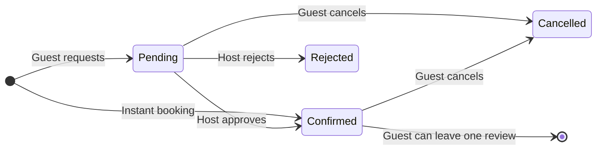
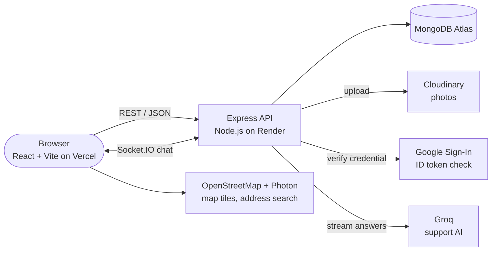
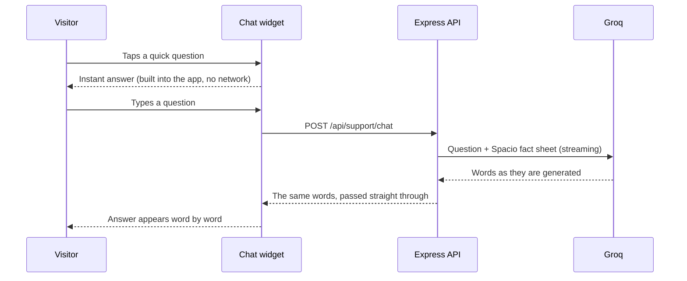

<div align="center">



<br />

[](https://spacio-beryl.vercel.app/)
[](https://react.dev/)
[](https://nodejs.org/)
[](https://www.mongodb.com/atlas)
[](https://socket.io/)

**Spacio turns unused physical spaces into income, and helps people find affordable space for a day or a month.**

[Overview](#overview) &nbsp;·&nbsp; [Features](#features) &nbsp;·&nbsp; [How it works](#how-it-works) &nbsp;·&nbsp; [Tech stack](#tech-stack) &nbsp;·&nbsp; [Architecture](#architecture) &nbsp;·&nbsp; [Getting started](#getting-started) &nbsp;·&nbsp; [Deployment](#deployment) &nbsp;·&nbsp; [Roadmap](#roadmap)

</div>

<!--
  After you push the repo, you can add live GitHub badges here. Replace USER and REPO:
  
  
-->

> **Heads up:** the server runs on a free Render instance, so the first request after a quiet period can take up to a minute while it wakes up. After that it is fast.

---

## Overview

Plenty of garages, parking spots, spare rooms and terraces sit empty, while other people struggle to find affordable storage, parking, a desk or a venue for a day. Spacio connects the two sides in one marketplace.

| 🏠 &nbsp;**For hosts** | 🔎 &nbsp;**For guests** |
|:--|:--|
| List a space with photos, a map location, a daily price and your contact number. | Search by category, city, budget, free dates or distance from you. |
| Approve requests yourself, or switch on instant booking. | Request a booking, or book instantly when the host allows it. |
| Edit or delete your spaces, chat with guests and track requests on a simple dashboard. | Chat with the host, call them directly, and leave a review. |

### What can you rent?

| | Category | Examples |
|:-:|:--|:--|
| 📦 | **Storage** | Garages, spare rooms, warehouses, inventory space |
| 🚗 | **Parking** | Spots for cars, bikes and commercial vehicles |
| 💼 | **Workspaces** | Private offices, meeting rooms, coworking spots, studios |
| 🎉 | **Event spaces** | Terraces, party halls, photography venues |
| ⚽ | **Sports** | Courts, turfs, pitches and grounds |
| 🧩 | **Other** | Anything that does not fit the rest |

---

## Features

<table>
<tr>
<td width="33%" valign="top">

**Discovery**
- Filter by category, city, max price and free dates
- "Near me" search within 10 km
- Grid or map view with price pins
- Open any space in Google Maps, with directions

</td>
<td width="33%" valign="top">

**Booking**
- Request booking or instant booking
- Host approve / reject flow
- Double-booking protection
- "Unavailable today" badge on booked spaces

</td>
<td width="33%" valign="top">

**Community**
- Live chat for every booking (Socket.IO)
- One review per confirmed booking
- Host phone number with Call and WhatsApp buttons
- Profile page for name, email and mobile, and a delete-account option

</td>
</tr>
<tr>
<td width="33%" valign="top">

**Sign in**
- Email and password (hashed, JWT)
- **Continue with Google**, checked on the server
- Protected pages and role-safe APIs

</td>
<td width="33%" valign="top">

**Hosting a space**
- Up to 4 photos, with remove and reorder
- Address search with suggestions, click or drag the pin
- Edit or delete your spaces any time
- Dashboard: spaces, pending requests, confirmed and upcoming bookings

</td>
<td width="33%" valign="top">

**AI support assistant**
- Round chatbot button on every page
- Quick questions answered instantly
- Free questions streamed word by word (Groq)
- Privacy Policy and Terms of Use pages included

</td>
</tr>
</table>

<details>
<summary><b>See the full feature list</b></summary>

<br />

- **Accounts:** register and log in with email and password (bcrypt, 7-day JWT) or with Google; Google users are matched by Google ID so changing the email never creates a duplicate account.
- **Profile and settings:** an account menu on the round letter icon; edit name, email and mobile number; log out from the menu only.
- **Listings:** six categories (Storage, Parking, Workspaces, Event spaces, Sports, Other); title, description, address, city, price (per day or per hour), instant-booking switch, contact number and up to 4 photos (5 MB each) stored on Cloudinary.
- **Edit and delete:** hosts can change anything, including photos (keep, remove, reorder, add) and the map pin. Deleting a space also removes its bookings, chats, reviews and photos.
- **Demo listings:** every space owned by the demo account (the Spacio support email) carries a "Demo listing" tag and a short notice.
- **Location:** search an address (OpenStreetMap data through Photon) and pick a suggestion, click the map, drag the pin, or use your own location. Locations are saved as GeoJSON with a `2dsphere` index.
- **Search:** category, city, max price (per day or per hour), free dates (per-day spaces with confirmed bookings in the range are hidden) and a 10 km "near me" mode. A per-day space with a confirmed booking for today shows **Unavailable today**; a per-hour space with some hours taken shows **Booked today** and lists those hours.
- **Bookings:** a space is priced **per day** (guests pick a start and end date; total is `price × days`, first and last day both count) or **per hour** (guests pick one date and whole hours such as 2:00 PM to 4:00 PM; total is `price × hours`). Past dates and times, your own spaces, and dates or hours that are already booked are rejected. Hours right before or after an existing booking are fine.
- **Statuses:** `pending → approved` (shown as **Confirmed**), or `rejected` / `cancelled`. Guests can cancel a pending or confirmed booking.
- **No online payments:** Spacio does not handle money. After a booking is confirmed, guest and host agree on payment directly through the chat or by phone (a **Call host** button is shown).
- **Chat:** one private room per booking; only the host and guest can join; history is saved in MongoDB.
- **Reviews:** only the guest of a confirmed booking, once per booking; the average rating shows on the space page.
- **Account deletion:** from Profile & settings (password and the word DELETE are required). It removes the user's spaces, bookings, chats and reviews.
- **Contact privacy:** a host's number is never sent in search results and is only returned to logged-in users.
- **Support bot:** a fact sheet about Spacio is sent with every question; answers stream from Groq; limited to 15 messages per minute per visitor.
- **Legal:** Privacy Policy (`/privacy`) and Terms of Use (`/terms`), linked from the login page and the footer.
- **Design:** responsive layout with a black, white and electric-lime theme, loading skeletons, empty and error states.

</details>

<!--
  SCREENSHOTS: add your images to docs/screenshots/ and remove this comment markers.

  ## Screenshots

  | Home | Space details |
  |:--:|:--:|
  |  |  |
  | **List a space** | **My bookings** |
  |  |  |
-->

---

## How it works



1. **A host lists a space** with photos, a map location, a daily price and a contact number.
2. **A guest searches and picks dates.** The total is shown before booking.
3. **The host approves** (or the booking is instant), and it shows as **Confirmed**.
4. **Both sides talk** in the booking chat or by phone, and agree on payment and handover directly.
5. **The guest can review the space** afterwards.

---

## Tech stack

<div align="center">

[](https://react.dev/)
[](https://vite.dev/)
[](https://leafletjs.com/)
[](https://expressjs.com/)
[](https://mongoosejs.com/)
[](https://jwt.io/)
[](https://cloudinary.com/)
[](https://groq.com/)
[](https://vercel.com/)
[](https://render.com/)

</div>

| Layer | Technology | What it does |
|:--|:--|:--|
| Frontend | React 18, Vite, React Router, Axios | The single-page app and its routing |
| Styling | Plain CSS with design tokens | Brand colors, responsive layout, animations |
| Maps | Leaflet, OpenStreetMap, Photon | Map view, price pins, address search |
| Backend | Node.js, Express | REST API and Socket.IO server |
| Database | MongoDB Atlas, Mongoose | Users, listings, bookings, reviews, messages |
| Auth | JWT, bcrypt, Google Identity Services | Email login and "Continue with Google" |
| Images | Cloudinary, Multer | Listing photo upload and delivery |
| Real time | Socket.IO | Booking chat |
| AI | Groq (`openai/gpt-oss-20b`) | Streaming answers for the support assistant |
| Hosting | Vercel (client), Render (server) | Deployment |

---

## Architecture



### The support assistant



<details>
<summary><b>Project structure</b></summary>

```
Spacio/
├── client/                      React + Vite app (deployed on Vercel)
│   ├── index.html
│   ├── vercel.json              makes page refresh work on Vercel
│   └── src/
│       ├── App.jsx              all routes
│       ├── AuthContext.jsx      who is logged in
│       ├── api.js, utils.js     axios setup and small helpers
│       ├── index.css            design system (colors, buttons, layouts)
│       ├── components/          Navbar, Footer, ListingCard, Maps, SupportChat, GoogleButton ...
│       ├── pages/               Home, ListingDetails, CreateListing, OwnerDashboard,
│       │                        MyBookings, Chat, Profile, AuthPage, Legal
│       └── legal/               Privacy Policy and Terms text (content.js, config.js)
├── server/                      Express API (deployed on Render)
│   ├── server.js                Express + Socket.IO + MongoDB start-up
│   ├── config/cloudinary.js     photo upload
│   ├── middleware/              auth.js, optionalAuth.js
│   ├── models/                  User, Listing, Booking, Review, Message
│   ├── routes/                  auth, listings, bookings, reviews, messages, support
│   ├── support/knowledge.js     fact sheet the AI assistant answers from
│   └── utils/                   phone, dates (today in India), demo tag, cleanup of deleted data
└── docs/                        banner and footer images
```

</details>

<details>
<summary><b>API overview</b></summary>

| Area | Endpoint | Notes |
|:--|:--|:--|
| Auth | `POST /api/auth/register`, `/login`, `/google` | Returns a JWT and the user |
| Profile | `GET`, `PUT` and `DELETE /api/auth/me` | Name, email, mobile; delete the account (login required) |
| Listings | `GET /api/listings` | Filters: `category`, `city`, `maxPrice` with `priceUnit` (`day` or `hour`), `startDate`, `endDate`, `lat`, `lng` |
| | `GET /api/listings/:id` | Includes the host phone only for logged-in users |
| | `GET /api/listings/mine` | The host's own spaces |
| | `POST /api/listings`, `PUT /api/listings/:id` | Create or edit. Photos sent as multipart form data |
| | `DELETE /api/listings/:id` | Also removes bookings, chats, reviews and photos |
| Bookings | `POST /api/bookings` | Request or instant booking. Per-day spaces send `startDate` and `endDate`; per-hour spaces send `startDate`, `startTime` and `endTime` |
| | `GET /api/bookings/mine`, `/requests`, `/:id` | Guest view, host view, one booking |
| | `PUT /api/bookings/:id/status` | Approve, reject or cancel |
| Reviews | `GET /api/reviews/listing/:id`, `POST /api/reviews` | Only for confirmed bookings |
| Chat | `GET /api/messages/:bookingId` | History; live messages use Socket.IO (`join`, `send`, `message`) |
| Support | `POST /api/support/chat` | Streamed plain-text answer |
| Health | `GET /health` | Used by Render |

</details>

---

## Getting started

**You will need:** Node.js 20 or newer, a free [MongoDB Atlas](https://www.mongodb.com/atlas) cluster, and a free Cloudinary account. Groq and Google sign-in are optional.

### 1. Get the code

```bash
git clone <your-repository-url>
cd Spacio
```

### 2. Start the server

```bash
cd server
npm install
cp .env.example .env     # then fill in the values below
npm run dev
```

You should see `MongoDB connected` and `Server running on port 5000`.

### 3. Start the website

```bash
cd client
npm install
cp .env.example .env     # optional, see below
npm run dev
```

Open **http://localhost:5173**.

### Environment variables

<details open>
<summary><b>server/.env</b></summary>

| Variable | Required | Where to get it |
|:--|:-:|:--|
| `MONGO_URI` | yes | MongoDB Atlas: Connect, Drivers. Add a database name, for example `/spacio` |
| `JWT_SECRET` | yes | Any long random text (generate a new one for the live site) |
| `CLIENT_URL` | yes | The website address, for example `http://localhost:5173`. Several addresses can be separated by commas |
| `CLOUDINARY_CLOUD_NAME`, `CLOUDINARY_API_KEY`, `CLOUDINARY_API_SECRET` | yes | Cloudinary dashboard |
| `GROQ_API_KEY` | no | console.groq.com. Without it the typed support chat shows "not set up yet" |
| `GROQ_MODEL` | no | Defaults to `openai/gpt-oss-20b` |
| `GOOGLE_CLIENT_ID` | no | Google Cloud, Google Auth Platform, Clients |
| `DEMO_EMAIL` | no | Listings created by this account get a "Demo listing" tag. Defaults to the Spacio support email |

</details>

<details open>
<summary><b>client/.env</b></summary>

| Variable | Required | Notes |
|:--|:-:|:--|
| `VITE_API_URL` | live site only | Address of the server. Defaults to `http://localhost:5000` |
| `VITE_GOOGLE_CLIENT_ID` | no | Same Client ID as the server. Without it the Google button is hidden |

Vite reads these values when it starts or builds, so restart `npm run dev` (or redeploy) after changing them.

</details>

### Try the whole flow

1. Sign up as user A and click **List a space**. Search an address, add photos and a phone number.
2. Sign up as user B in a private window and book that space.
3. As user A open **My spaces** and approve the request.
4. As user B open **My bookings**: the booking shows **Confirmed**. Use **Chat** or **Call host**, then leave a review.
5. As user A, try **Edit** on your space, and check that a booked space shows **Unavailable today**.

---

## Deployment

| Part | Service | Settings |
|:--|:--|:--|
| Database | MongoDB Atlas | Network Access: allow `0.0.0.0/0` (Render's addresses change) |
| Server | Render (Web Service) | Root Directory `server`, Build `npm install`, Start `npm start`, Health Check `/health`, add the variables above plus `NODE_VERSION=22` |
| Website | Vercel | Root Directory `client`, add `VITE_API_URL` (the Render address, no trailing `/`) and `VITE_GOOGLE_CLIENT_ID` |

Then set `CLIENT_URL` on Render to the Vercel address and add the same address to the Google OAuth client's **Authorized JavaScript origins**.

---

## Security notes

- Passwords are stored only as bcrypt hashes. Google credentials are verified on the server against your Client ID.
- Spacio never handles money or card details.
- Deleting a space or an account also deletes the related bookings, chats, reviews and photos, so no orphan data is left behind.
- Protected routes check a JWT. Listings, bookings, chat and reviews check that you are the owner or the guest.
- Host phone numbers are left out of search results and only sent to logged-in users.
- CORS only allows the addresses in `CLIENT_URL`. Uploads are limited to 4 images of 5 MB each. The support chat is limited to 15 messages per minute per visitor.
- `.env` files are ignored by Git. Only the `.env.example` files are committed.

---

## Roadmap

- [x] Listings, search, map, bookings and approvals
- [x] Booking chat and reviews
- [x] Google sign-in, profile page and AI support assistant
- [x] Edit and delete listings, delete account
- [x] Sports and Other categories, demo tag, "Unavailable today" badge
- [x] Per-hour pricing and hourly bookings
- [x] Privacy Policy and Terms of Use
- [ ] Online payments and refunds (removed for now)
- [ ] Password reset and email verification
- [ ] Saved spaces and an availability calendar
- [ ] Notifications for new requests and messages
- [ ] Automated tests

---

## About the developer

Built by **Saurabh Kishor Tatar**, as a full-stack portfolio project.

<!-- Add your links, for example:
[](https://your-site)
[](https://github.com/YOUR-USERNAME)
[](https://www.linkedin.com/in/YOUR-PROFILE)
-->

Suggestions and bug reports are welcome through GitHub issues.

## License

No license file is included yet, so all rights are reserved by the author. Add a `LICENSE` file if you want others to be able to reuse the code.

<br />


